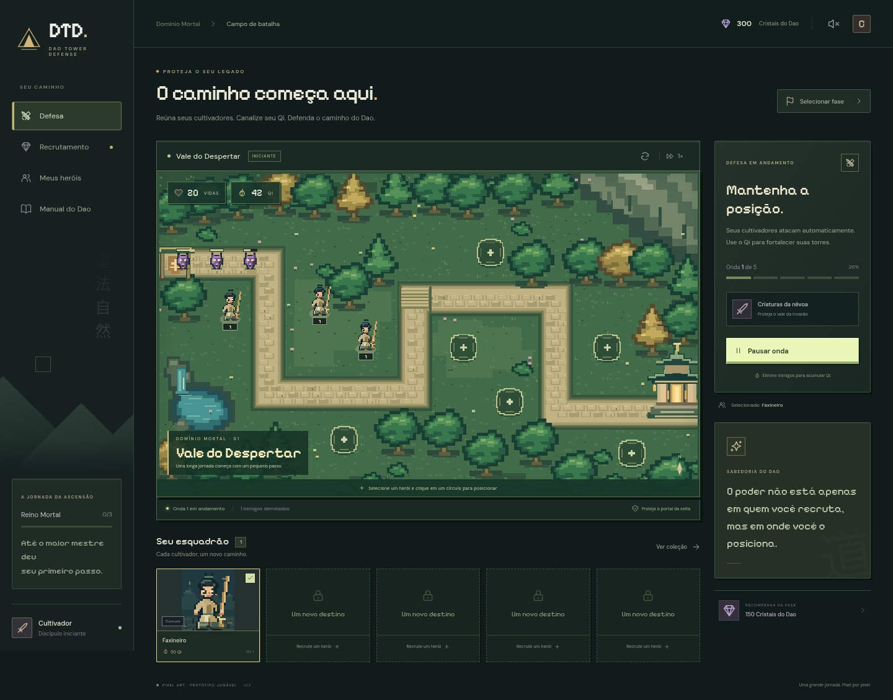

# DTD — Dao Tower Defense

Protótipo jogável de tower defense para navegador no computador, em português, com temática de cultivo inspirada em *Martial Peak*. Arte em pixels e personagens originais.

Você começa com o **Faxineiro**, o servo que varre os pátios do Pavilhão Ling Xiao. As **12 fases** seguem a jornada do **Mundo Inicial** do *Black Book Idle*, do Pavilhão Ling Xiao ao Portal para o Reino Tong Xuan, cada uma com o chefe e os inimigos do mapa correspondente. Posicione cultivadores, derrote cinco ondas por fase e ganhe **Cristais do Dao** para recrutar novos heróis.

A arte é **chibi em pixel art**: os 14 heróis, os inimigos, os chefes e os cenários pintados foram gerados a partir dos prompts em `docs/PROMPTS_HEROIS_CHIBI.md` e `docs/PROMPTS_MUNDO1.md`, com os chibis do Black Book Idle como referência. Cada cenário tem seu próprio caminho e suas nove plataformas. Fases que ainda não têm arte (hoje a 7 e a 10) usam o cenário e as criaturas desenhados em código, em SVG.



## Jogar no navegador com GitHub Pages

Depois de uma publicação concluída com sucesso, o endereço do jogo será **https://wamberto10.github.io/DTD/**. A presença do código no repositório, por si só, não torna esse endereço disponível.

Para ativar a hospedagem no repositório `wamberto10/DTD`:

1. Envie o código e o workflow `.github/workflows/deploy.yml` para a branch `main`.
2. No GitHub, abra **Settings → Pages → Build and deployment** e selecione **GitHub Actions** em **Source**.
3. Em **Actions**, acompanhe **Deploy DTD to GitHub Pages**. Se necessário, use **Run workflow** para publicar a versão atual.
4. Abra o endereço acima após as etapas de build e deploy terminarem com sucesso.

Novos envios para `main` executam os testes, geram `dist/` e publicam automaticamente. Os recursos usam caminhos relativos para funcionar sob `/DTD/`. O jogo é estático; sua coleção e seu progresso continuam salvos no navegador que você usa para jogar.

## Jogar sem instalar ferramentas

Abra o arquivo `dist/DTD-Dao-Tower-Defense.html` no Chrome, Edge ou Firefox com dois cliques. Essa versão inclui todos os recursos e funciona sem servidor ou conexão com a internet. Mantenha o arquivo no mesmo local e use o mesmo navegador para continuar seu progresso salvo.

Para gerar ou atualizar esse arquivo a partir do código, execute `npm run build:portable` após instalar as dependências.

## Executar

Requer Node.js 20.19+ ou 22.12+ e npm. O ambiente foi validado com Node.js 24.

```bash
cd /workspace/DTD
npm ci --cache /tmp/dtd-npm-cache
npm run dev
```

O Vite informa o endereço local no terminal. Para gerar uma versão estática de produção, execute `npm run build`; os arquivos ficam em `dist/`. `npm run preview` serve essa versão para conferência.

## Como jogar

1. Na aba **Esquadrão**, escolha até 5 heróis para levar à batalha. Só eles aparecem na Defesa e podem ser posicionados. Heróis novos entram sozinhos enquanto houver vaga.
2. Na Defesa, selecione um herói do esquadrão e clique em um círculo no mapa. Você pode posicionar várias torres do mesmo herói.
3. Clique em **Iniciar onda**. Os cultivadores atacam automaticamente os inimigos em seu alcance. Depois da primeira, cada onda começa sozinha 5 segundos após a anterior; **Começar agora** pula a espera.
4. Cada eliminação concede Qi. Clique em uma torre para ver seu alcance e melhorá-la até o nível 5. Dispensar uma torre recupera 70% do Qi investido.
5. Proteja o local da fase durante as cinco ondas, incluindo o chefe final. Uma vitória libera a próxima fase e concede cristais.
6. Visite **Recrutamento** para invocar heróis e **Meus heróis** para conferir a coleção e elevar as estrelas dos heróis com os fragmentos.

**Espaço** inicia a onda (ou pula a espera), **P** ou o botão ao lado da velocidade pausa a partida, **2** alterna a velocidade e **Esc** fecha detalhes. A pausa também para a contagem entre ondas. A partida pausa sozinha ao sair da defesa ou ocultar a aba.

## Progressão e recrutamento

Há 14 heróis em sete raridades e 12 fases com dificuldade crescente: a vida dos inimigos sobe 18% a cada fase. Só com o Faxineiro, jogando bem, dá para vencer todas; a partir da fase 9 ele começa a perder vidas, e os heróis recrutados fazem diferença. Todo jogador recebe 300 cristais iniciais. Uma invocação custa 100 cristais; dez custam 900. Não há garantia acumulada nem monetização.

| Raridade | Chance por invocação |
| --- | ---: |
| Comum | 45% |
| Incomum | 25% |
| Raro | 15% |
| Épico | 9% |
| Lendário | 4,5% |
| UR | 1,2% |
| UR+ | 0,3% |

O sorteio escolhe primeiro a raridade e depois um dos dois heróis dela, com chances iguais. Um herói repetido vira **50 fragmentos** dele. Na ficha do herói, em **Meus heróis**, os fragmentos elevam suas estrelas, sem limite. As estrelas vêm em grupos de cinco: o primeiro grupo (Ouro) custa 25, 25, 25, 50 e 50 fragmentos; cada grupo seguinte muda a cor das estrelas (Rubi, Ametista, Safira, Jade e Celestial) e custa o dobro do anterior (50, 50, 50, 100, 100; depois 100, 100, 100, 200, 200; e assim por diante). Cada estrela soma +10% de dano e +3% de ataques por segundo, também para as torres já posicionadas. Perfis antigos recebem fragmentos pelas cópias repetidas que já tinham. A primeira vitória em cada fase concede de 150 cristais (fase 1) a 425 (fase 12), 25 a mais por fase; repetir uma fase concede 50.

Heróis, cristais e fases concluídas ficam salvos no `localStorage` deste navegador. Qi, torres, melhorias e partidas em andamento são temporários e reiniciam ao trocar de fase, reiniciar ou recarregar. Não há conta, servidor de progressão ou sincronização entre dispositivos.

## Validação

```bash
npm test
npm run build
```

Os testes de lógica verificam combate, Qi, melhorias, vitória e derrota, as 12 fases com os dados reais do Faxineiro, as plataformas de cada cenário, probabilidades, recompensas e persistência.

Há também testes completos de navegador. Com o servidor de desenvolvimento ativo, Python Playwright e Chromium disponíveis:

```bash
python3 tests/battle_smoke.py
python3 tests/recruitment_smoke.py
```

Os scripts usam `/usr/bin/chromium` por padrão; `CHROMIUM_PATH` permite outro caminho, e `DTD_TEST_URL` permite outro endereço do servidor.

## Arte

A arte original, em tamanho grande, fica em `arte/ia/` (`herois/`, `inimigos/`, `chefes/` e `fases/`, com os nomes dos documentos de prompts). O jogo usa cópias leves em WebP, em `public/arte/`. Depois de adicionar ou trocar uma imagem, execute:

```bash
npm run arte
```

O comando gera as cópias e atualiza `src/art-manifest.js`. Um cenário novo também precisa do caminho e das nove plataformas traçados em `src/maps.js`; até lá, a fase usa o caminho padrão.

O Servo Arrogante já usa animação por peças a partir de um PSD em `arte/ia/inimigos-pecas/`. `npm run arte:pecas`
atualiza só esses recortes; `npm run arte` também os inclui. A versão portátil incorpora todas as peças. O guia,
as regras dos PSDs e a prévia estão em [docs/ANIMACAO_INIMIGOS.md](docs/ANIMACAO_INIMIGOS.md).

## Migração para o Unity

O plano está em `docs/MIGRACAO_UNITY.md`. Para gerar o pacote com dados (JSON), arte (PNG) e casos de teste para a versão Unity:

```bash
npm run unity
```

O resultado fica em `unity-export/`, fora do git, e pode ser gerado de novo a qualquer momento. Todos os números do combate ficam em `BALANCE`, em `src/engine.js`.

## Estrutura

- `src/engine.js`: simulação do combate, independente da interface; os números ficam em `BALANCE`.
- `src/maps.js`: caminho dos inimigos e plataformas de cada cenário.
- `src/stars.js`: fragmentos, custo e bônus das estrelas dos heróis.
- `src/data.js`: heróis, raridades, atributos e as 12 fases do Mundo Inicial.
- `src/chibi-art.js` e `src/art-manifest.js`: arte chibi de heróis, inimigos e cenários.
- `scripts/preparar-arte.mjs`: gera `public/arte/` a partir de `arte/ia/`.
- `scripts/exportar-unity.mjs`: gera o pacote `unity-export/` para o Unity.
- `src/profile.js`: gacha, recompensas e persistência local.
- `src/art.js`: exportações de arte e ícones da interface.
- `src/pixel-terrain.js`: cenário em pixels e paletas das três fases.
- `src/pixel-portraits.js`: 14 heróis em pixels e variantes transparentes.
- `src/pixel-units.js`: criaturas, posições e projéteis em pixels.
- `src/app.js` e `src/style.css`: interface e interação.

As fontes são distribuídas junto com o jogo; a aplicação não depende de serviços externos durante a partida. Esta versão roda no navegador, sem instalador nativo para Windows.
