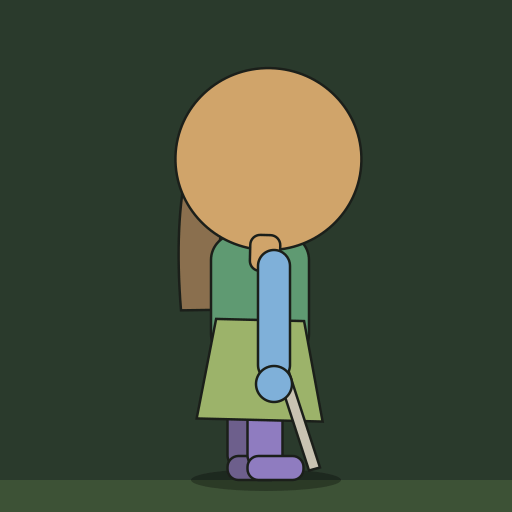
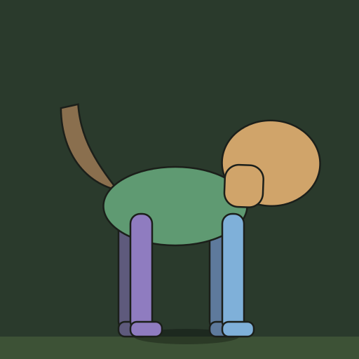
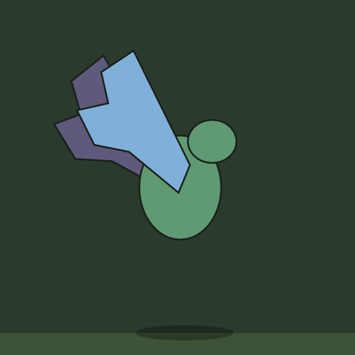

# DTD — Inimigos animados por peças (esqueleto)

Cada inimigo vira um **boneco de recortes**: uma imagem cortada em peças (cabeça, tronco, braços, pernas…)
que o jogo gira nas juntas. Assim o movimento fica liso em qualquer velocidade e tamanho de tela, e **um só
movimento de andar serve para todos os inimigos do mesmo tipo de corpo**. Ninguém precisa desenhar quadro a quadro.

| Humanoide | Quadrúpede | Voador |
|---|---|---|
|  |  |  |

As animações acima são os próprios moldes se mexendo do jeito que o jogo vai mexer as peças.

## O que entregar

- **Um arquivo PSD por inimigo**, com **uma camada por peça**. Photopea (grátis, no navegador), Krita, GIMP e
  Photoshop salvam PSD.
- **Onde salvar:** inimigos em `arte/ia/inimigos-pecas/`, chefes em `arte/ia/chefes-pecas/`, com o mesmo nome da
  imagem atual trocando `.png` por `.psd`. Exemplo: `arte/ia/inimigos-pecas/f01_comum_servo_arrogante.psd`.
- Enquanto um inimigo não tiver o PSD, o jogo continua usando a imagem atual dele.

## Regras do arquivo

| Regra | Valor |
|---|---|
| Tela | **1024 × 1024 px**, fundo transparente |
| Posição | Pés na **linha amarela** do molde, corpo no **centro** (o molde mostra as duas linhas) |
| Altura | Do topo da cabeça aos pés: de 750 a 880 px. Chefes podem chegar a 900 px |
| Direção | **De lado, olhando para a direita**, na mesma vista dos inimigos atuais (o jogo espelha para a esquerda) |
| Pose | **Pose de montagem**: em pé e parado, não no meio do passo. Braços soltos ao lado do corpo, pernas retas para baixo |
| Camadas | Uma por peça, com os **nomes exatos** do molde e na **ordem** do molde |
| Juntas | Cada peça desenhada **inteira**, inclusive a parte que fica escondida atrás das outras |
| Sem | Sombra, chão, aura, brilho, rastro de golpe e texto: o jogo faz esses efeitos |

Todos os inimigos usam a mesma tela de 1024 px para o jogo usar uma escala só. No mapa ele fica bem menor (uns 45 px),
então detalhes minúsculos não aparecem: o que importa é a silhueta.

## As peças de cada tipo de corpo

Os moldes ficam em `docs/moldes/`. Abra o do tipo certo e desenhe por cima. O **ponto vermelho** é a junta, onde a
peça gira. Você **não precisa marcar as juntas**: o jogo acha sozinho pelo formato e pela posição de cada peça (o topo
do braço é o ombro, o topo da perna é o quadril, a base da cabeça é o pescoço). Por isso as peças precisam estar na
posição do molde, com braços e pernas pendurados para baixo.

### Humanoide: pessoas, cultivadores, demônios em pé — `moldes/molde-humanoide.png`

| Camada (de baixo para cima) | O que entra | Onde gira |
|---|---|---|
| `cabelo-tras` (opcional) | Cabelo comprido, rabo de cavalo e fitas que caem atrás das costas | Onde prende na cabeça |
| `braco-tras` | Braço de trás, com a mão | Ombro |
| `perna-tras` | Perna de trás, com o pé | Quadril |
| `perna-frente` | Perna da frente, com o pé | Quadril |
| `tronco` | Peito, barriga, cintura e pescoço | Quadril (balança junto com o corpo) |
| `saia` (opcional) | A parte de baixo do robe ou da túnica que cobre as pernas | Cintura |
| `cabeca` | Rosto, cabelo da frente, coque, chapéu, coroa | Pescoço |
| `arma` (opcional) | O que ele segura: bastão, espada, leque | Segue a mão (fica logo abaixo do braço da frente) |
| `braco-frente` | Braço da frente, com a mão | Ombro |

### Quadrúpede: lobos, javalis, macacos de quatro — `moldes/molde-quadrupede.png`

| Camada (de baixo para cima) | O que entra | Onde gira |
|---|---|---|
| `cauda` (opcional) | O rabo | Onde prende no corpo |
| `pata-tras-longe` | Pata de trás, do lado de lá | Quadril |
| `pata-frente-longe` | Pata da frente, do lado de lá | Ombro |
| `corpo` | Tronco do animal, sem patas, cabeça nem rabo | Balança no lugar |
| `pata-tras-perto` | Pata de trás, do lado de cá | Quadril |
| `pata-frente-perto` | Pata da frente, do lado de cá | Ombro |
| `cabeca` | Cabeça com pescoço, orelhas, chifres e presas | Onde prende no corpo |

### Voador: morcegos, pássaros, insetos — `moldes/molde-voador.png`

| Camada (de baixo para cima) | O que entra | Onde gira |
|---|---|---|
| `asa-longe` | Asa do lado de lá | Onde prende no corpo |
| `corpo` | Corpo com a cabeça, as patas e o rabo | Sobe e desce no ar |
| `asa-perto` | Asa do lado de cá | Onde prende no corpo |

Voadores não têm linha dos pés: o centro do corpo fica na linha **ALTURA DE VOO** do molde.

## A parte escondida (o segredo do movimento bom)

O topo da perna fica atrás do tronco. Quando a perna gira para a frente, esse pedaço aparece: se ele não estiver
desenhado, abre um buraco no boneco. Por isso:

- **Pernas e braços:** desenhe o topo arredondado e inteiro, entrando uns **50 px** para dentro do tronco.
- **Cabeça:** o pescoço desce uns **40 px** para dentro do tronco.
- **Cabelo, saia, cauda e asas:** a base entra um pouco por trás da peça onde prende.
- Nos moldes, as peças são transparentes justamente para mostrar onde elas se sobrepõem.

## Passo a passo para cada inimigo

1. **Gere a pose de montagem com IA** usando os prompts abaixo. Anexe a imagem atual do inimigo (por exemplo
   `arte/ia/inimigos/f01_comum_servo_arrogante.png`) como referência, para sair o mesmo personagem.
2. **Monte no Photopea** ([photopea.com](https://www.photopea.com)):
   1. *Arquivo → Abrir* (File → Open): o molde do tipo de corpo, por exemplo `docs/moldes/molde-humanoide.png`.
   2. *Arquivo → Abrir e posicionar* (File → Open & Place): a imagem da pose. Arraste os cantos segurando Shift até
      os pés tocarem a linha amarela e o corpo ficar no centro. Aperte Enter.
   3. **Recorte as peças, da frente para trás** (braço da frente, arma, cabeça…): com a camada do inimigo selecionada,
      contorne a peça com o **Laço** (tecla L) e aperte **Ctrl+Shift+J** (Camada via recorte / Layer via Cut). A peça
      vai para uma camada só dela. Dê dois cliques no nome da camada e escreva o nome exato da tabela.
   4. **Complete as partes escondidas** de cada peça: pinte a continuação com o Pincel (B), pegando a cor com o
      conta-gotas (I). Se preferir, peça para uma IA completar só aquele pedaço.
   5. Deixe as camadas **na ordem da tabela** e **apague a camada do molde**.
   6. *Arquivo → Salvar como PSD* (File → Save as PSD) na pasta `arte/ia/inimigos-pecas/`.
3. **Avise o Claude**, por exemplo "servo arrogante recortado". O Claude coloca o boneco no jogo e confere o movimento.

**Comece por um só inimigo** (sugestão: o Servo Arrogante). Assim dá para conferir o resultado no jogo antes de recortar os outros.

## Prompts da fase 1

### Final igual em todos os humanoides (cole depois de cada prompt)
```
Chibi pixel art game enemy, full body, side view facing RIGHT, NEUTRAL STANDING POSE for 2D cut-out animation rigging: standing still and straight, both legs straight down and slightly apart (the far leg partly visible behind the near leg), both arms hanging relaxed along the body with a small gap between each arm and the torso, nothing crossing in front of the torso, long hair and ribbons falling behind the back without covering the arms. ONLY ONE character, real transparent background (not a checkerboard pattern), no text, no frame, no ground, no shadow, no aura, no glow, no motion effects. Chibi proportions: oversized head, short body and legs. Clean thick dark outline, crisp pixels, no blur. Same character, colors, outfit and pixel-art style as the attached image, same hostile expression.
```

### Final igual em todos os quadrúpedes (cole depois de cada prompt)
```
Chibi pixel art game enemy, full body, side view facing RIGHT, NEUTRAL STANDING POSE for 2D cut-out animation rigging: standing still on all four legs, all four legs straight down and clearly separated with visible gaps between them (the far legs partly visible behind the near legs), body horizontal, head forward, tail raised behind and away from the body, nothing overlapping the legs. ONLY ONE creature, real transparent background (not a checkerboard pattern), no text, no frame, no ground, no shadow, no aura, no glow, no motion effects. Chibi proportions: oversized head. Clean thick dark outline, crisp pixels, no blur. Same creature, colors and pixel-art style as the attached image, same hostile expression.
```

### Comum — Servo Arrogante (humanoide) → `f01_comum_servo_arrogante.psd`
Referência: `arte/ia/inimigos/f01_comum_servo_arrogante.png`
```
an arrogant senior servant of a martial sect: a smug young man in a plain grey-brown servant robe with a better belt than the other servants, chin raised, sleeves rolled up, holding a wooden stick in his front hand with the stick pointing down along his leg, mocking sneer.
```
Peças: `cabelo-tras`, `braco-tras`, `perna-tras`, `perna-frente`, `tronco`, `saia` (a parte de baixo do robe), `cabeca`, `arma` (o bastão), `braco-frente`.

### Rápido — Macaco Ladrão (quadrúpede) → `f01_rapido_macaco_ladrao.psd`
Referência: `arte/ia/inimigos/f01_rapido_macaco_ladrao.png`
```
a small thieving monkey of the bamboo forest: brown fur, a long curled tail, a red scarf, a stolen red sect token tied to its belt, mischievous grin.
```
Peças: `cauda`, `pata-tras-longe`, `pata-frente-longe`, `corpo` (com o lenço e o amuleto), `pata-tras-perto`, `pata-frente-perto`, `cabeca`.

### Forte — Valentão dos Alojamentos (humanoide) → `f01_forte_valentao_alojamentos.psd`
Referência: `arte/ia/inimigos/f01_forte_valentao_alojamentos.png`
```
a big bully of the disciples' dormitory: a huge broad-shouldered young man in a stretched and torn outer-disciple uniform, thick neck, muscular arms hanging at his sides with big clenched fists, menacing grin.
```
Peças: `cabelo-tras`, `braco-tras`, `perna-tras`, `perna-frente`, `tronco`, `saia` (o pano da cintura), `cabeca`, `braco-frente`. Sem `arma`.

### Chefe — Discípulo Interno de Elite (humanoide) → `arte/ia/chefes-pecas/f01_chefe_discipulo_interno_elite.psd`
Referência: `arte/ia/chefes/f01_chefe_discipulo_interno_elite.png`
```
an elite inner disciple of the sect: a proud young swordsman in a refined white and dark green inner-disciple robe with silver trim, a jade pendant, hair in a neat topknot with a small silver crown, a long sword held low in his front hand with the blade pointing down and forward (not across the body), cold arrogant gaze. No sword qi and no aura: the game adds them.
```
Peças: `cabelo-tras`, `braco-tras`, `perna-tras`, `perna-frente`, `tronco`, `saia` (o robe), `cabeca`, `arma` (a espada), `braco-frente`.

## O que o jogo faz sozinho

- **Andar:** pernas e braços balançam em oposição, o corpo sobe e desce a cada passo, cabeça, cabelo, saia e cauda
  acompanham com um pequeno atraso.
- **Passo na velocidade certa:** o ritmo acompanha a velocidade de cada inimigo, para o pé não escorregar no chão.
  Rápidos dão passos curtos e ligeiros, fortes pisam pesado e chefes andam devagar e imponentes.
- **Efeitos:** espelhar para a esquerda, sombra, piscar ao levar dano, cair e sumir ao morrer e a aura dos chefes.

## Antes de salvar, confira

- [ ] Tela de 1024 × 1024, pés na linha amarela e corpo no centro.
- [ ] Cada peça numa camada só dela, com o nome exato da tabela (sem acento, com hífen).
- [ ] Camadas na ordem da tabela.
- [ ] Topo dos braços e das pernas, pescoço e bases desenhados por inteiro (nenhum buraco ao girar).
- [ ] Nenhum pedaço de uma peça sobrou na camada de outra (por exemplo, a mão da frente no tronco).
- [ ] Fundo transparente, sem sombra, sem aura e sem a camada do molde.

## Para quem mexe no código

Os moldes e as animações de prévia são gerados por `node scripts/moldes-animacao.mjs`. As medidas das peças e os
movimentos de prévia ficam nesse arquivo. O jogo Unity ainda não lê os PSDs: essa parte entra quando o primeiro
inimigo estiver recortado, para ser testada com arte de verdade.
